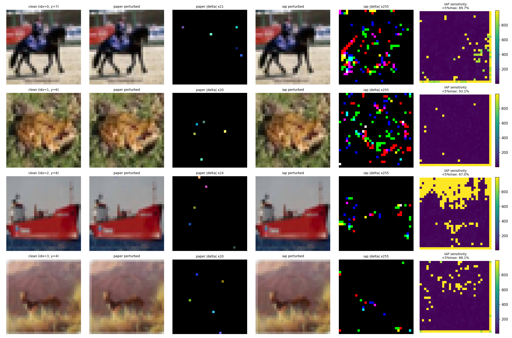
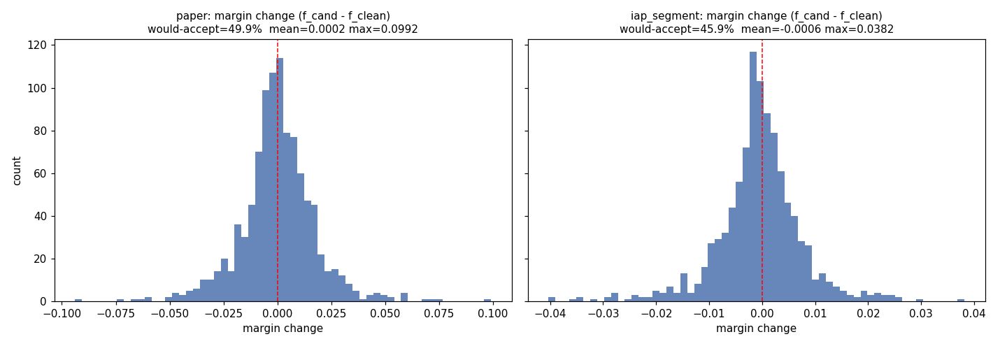
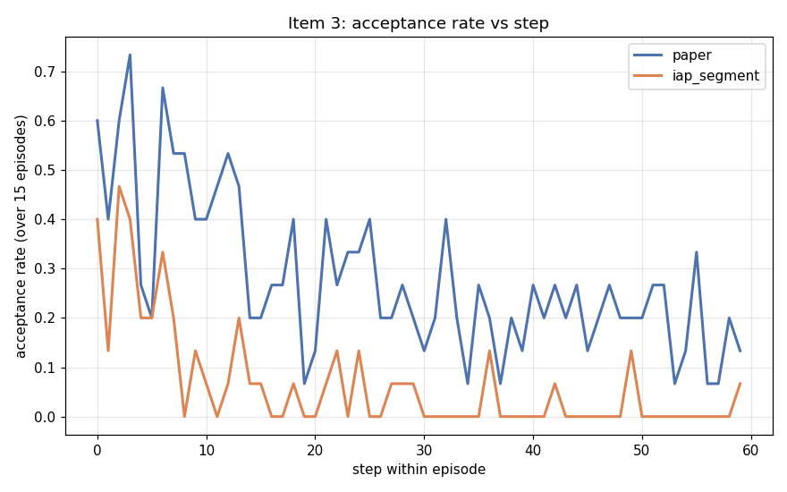
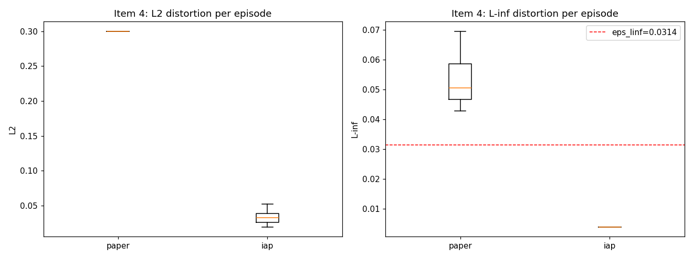

# Debug Report: paper vs. iap_segment perturbation arms

**Scope:** diagnostics only, no method changes. Victim = resnet50 (CIFAR-10, the
10-epoch checkpoint), held-out split D'. Both arms use εL∞=8/255,
G=16 (768-dim action), full-image mask. Random policy unless noted. All data
produced by `scratch/debug_report_data.py` and `scratch/item5_ppo_health.py`.

Figures: `figures/item1_perturbation_visuals.png`,
`figures/item2_proposal_margins.png`, `figures/item3_acceptance_over_time.png`,
`figures/item4_distortion.png`. Raw stats: `figures/debug_stats.json`,
`figures/item5_ppo_health.json`.

---

## Item 1 — Perturbation visuals + sensitivity

Columns: clean / paper-perturbed / paper |Δ| (amplified) / iap-perturbed /
iap |Δ| (amplified) / IAP sensitivity map, for 4 held-out images.

Fraction of pixels with sensitivity **< 5% of the per-image max**:

| idx 0 | idx 1 | idx 2 | idx 3 | mean |
|------|------|------|------|------|
| 0.897 | 0.931 | 0.670 | 0.881 | **0.845** |

**Conclusion.** The IAP sensitivity map is strongly non-uniform even at 32×32
(84.5% of pixels sit below 5% of the per-image peak — the peak is concentrated in
a few smooth, high-sensitivity regions), so the map itself is *not* degenerate.
But note the perturbation weight used in rendering is `weight = 1/sensitivity =
local_std + 0.001`, which is **small everywhere** at 32×32 (local 3-px std on a
[0,1] image is ≈0.01–0.2). The amplified Δ columns already hint at the real
problem quantified in Item 4: the paper Δ is visible and spread across a few
pixels, while the IAP Δ is far fainter — the budget is barely used.

---

## Item 2 — Proposal quality (20 images × 50 random actions, margin vs. current best)

Margin change = `f(candidate) − f(clean)` where `f = −log(conf_true)` (the exact
quantity hill-climbing accepts on; ≥ 0 ⇒ accepted). 1000 proposals per arm.

| arm | would-accept % | mean margin | max margin |
|-----|---------------|-------------|------------|
| paper | 49.9% | +0.00016 | 0.0992 |
| iap_segment | 45.9% | −0.00061 | 0.0382 |

**Conclusion.** From the clean start both arms accept ≈half of random proposals —
expected, since a tiny symmetric perturbation nudges the true-class confidence up
or down with roughly equal odds. But the *magnitude* of useful proposals differs:
the paper arm's best proposal moves the margin 2.6× further (0.099 vs 0.038), and
the IAP arm's **mean** margin is slightly negative. IAP proposals are individually
weaker because the realized perturbation is tiny (Item 4). The ~50% accept rate at
step 0 is noise-driven, not signal-driven — which is why it cannot be sustained
(Item 3).

---

## Item 3 — Acceptance rate vs. step within an episode

Acceptance rate at each step, averaged over 15 episodes, 60 steps each:

| arm | step 0 | steps 1–5 | steps ≥20 |
|-----|--------|-----------|-----------|
| paper | 0.60 | 0.44 | **0.213** |
| iap_segment | 0.40 | 0.28 | **0.023** |

**Conclusion.** Your hypothesis is **confirmed**. IAP's acceptance collapses to
~2% after step 20, an order of magnitude below the paper arm's ~21%. Once IAP has
taken its first lucky accepted step, almost no further random proposal improves the
margin — because each IAP proposal is a *fresh, independent* full-image render from
clean (not an increment), and essentially all of them land at the same crushed
magnitude, so they rarely beat the current best. The paper arm keeps accepting at a
sustained rate because its sparse increments accumulate on top of the best-so-far
and keep finding small improvements inside the L2 ball.

---

## Item 4 — Distortion per episode (L2 and L-inf)

| arm | L2 mean | L2 max | L-inf mean | L-inf max |
|-----|---------|--------|------------|-----------|
| paper | 0.300 | 0.300 | 0.0532 | 0.0696 |
| iap_segment | 0.0328 | 0.0522 | **0.00392** | **0.00392** |

**Conclusion — this is where the reward signal is lost.** The paper arm saturates
its L2 budget (0.30 = the configured ε-ball). The IAP arm's realized L-inf is
**pinned at exactly 1/255 ≈ 0.0039 in every episode** — only **12.5% of the 8/255
budget**, and identical across episodes because it is the uint8 **quantization
floor**. Mechanism: `Δ = action·(local_std+0.001)·ε`, then rounded to uint8. With
`local_std+0.001 ≈ 0.01–0.2` and `ε = 0.0314`, the pre-rounding Δ is ≈±0.0016 for
typical pixels (→ rounds to 0) and only ≈±0.007 at the highest-weight edge pixels
(→ ±1–2/255). So ~88% of the L-inf budget is never used and most of the action
vector is quantized to zero. The IAP perceptibility weighting — designed for
≥224² images where local std is larger — crushes the perturbation to near-zero at
32×32, so the victim's confidence barely moves and the margin signal is noise
rather than gradient.

---

## Item 5 — PPO health under target_kl = 0.03 (validation runs, 8 updates each)

Raw: `figures/item5_ppo_health.json`.

**paper arm:** every update runs the full 10/10 epochs; approx_kl stays well under
the cap (0.014 → 0.0006, declining); explained_variance 0.03–0.70; no NaN. The KL
stop never triggers, so target_kl leaves the paper arm's dynamics essentially
unchanged.

**iap_segment arm:** every update is stopped after **just 1 epoch** (one update hit
2) because a single epoch already drives approx_kl to **0.11–0.16**, far above the
1.5×0.03 = 0.045 threshold; explained_variance is high (0.84–0.97) only because the
value head trivially predicts ~0 returns; zero-reward fraction is **0.95–1.00**; no
NaN.

| arm | epochs/update | approx_kl (after 1 epoch) | expl_var | zero-reward frac | NaN |
|-----|---------------|---------------------------|----------|------------------|-----|
| paper | 10/10 | 0.014 → 0.0006 | 0.03–0.70 | 0.77–0.98 | none |
| iap_segment | **1/10** | 0.11–0.16 | 0.84–0.97 | **0.95–1.00** | none |

**Conclusion.** `target_kl=0.03` fixes the NaN: it halts each IAP update after one
epoch, before the 768-dim importance ratio can compound to `inf`. But it also
exposes that there is almost nothing to learn — 95–100% of steps are
hill-climbing rejects (zero reward), so each IAP update sees a near-empty learning
signal and the single allowed epoch already over-fits the sparse signal (huge KL).
The NaN was a symptom; the disease is the crushed perturbation from Item 4.

---

## Overall

The NaN is a numerical symptom of a 768-dim action whose log-probs are ~−1100;
`target_kl` contains it. The deeper finding is that the **IAP perceptibility
weighting crushes the perturbation to the uint8 quantization floor (~1/255, 12.5%
of the 8/255 budget) at 32×32**, so the victim's confidence barely changes, ~95–100%
of steps are rejected, and the reward signal degenerates to noise. Before any
training comparison is meaningful, the IAP rendering has to actually use its
distortion budget at CIFAR resolution — otherwise the two arms are not attacking
with comparable strength (Item 4: L2 0.30 vs 0.033).
